# TP6 — Microservices « Calculatrice » avec gRPC et Protocol Buffers

| | |
|---|---|
| **Établissement** | Faculté des Sciences de Sfax — Département d'informatique et des Communications |
| **Matière** | Architecture MicroServices — filière MPSRCC1 |
| **Enseignantes** | Corinne Amel ZAYANI, Amal ABID |
| **Année universitaire** | 2026-2027 |
| **Projet** | `calculatrice-spring-cloud` (réacteur Maven : eureka, config, calcul, historique, gateway) et dépôt de configuration `calculatrice-config-repo`, étendus pour ce TP |

## 1. Résumé de la réalisation

`calcul-service` expose désormais, à côté de son API REST (inchangée), un serveur gRPC (service `calcul.Calcul`, méthode `Calculer`). `historique-service` n'utilise plus OpenFeign pour obtenir un résultat : il retrouve les instances de `calcul-service` dans Eureka, lit leur métadonnée `grpc.port`, les sollicite à tour de rôle et appelle un stub gRPC bloquant. La passerelle, le serveur de configuration et Swagger UI ne changent pas.

| Partie | Contenu | État |
|---|---|---|
| A | Questions de conception | Réponses ci-dessous (section 6) |
| B | Contrat `calcul.proto`, plugin Maven, code généré | Réalisé, compilé (`BUILD SUCCESS`), code généré visible |
| C | `CalculGrpcService` (paquetage `rpc`), `GrpcExceptionHandler`, configuration, test Postman (C.5) | Réalisé, 7 requêtes exécutées |
| D | `CalculGrpcClient`, `OperationController` adapté, tests D.1 à D.5 | Réalisé, expériences D.2 et D.5 exécutées |
| E.1 | Passerelle inchangée | Vérifié |
| E.2 | Limite 500 puis 2000 dans le dépôt de configuration | Réalisé de bout en bout, deux scénarios |
| E.3 | Streaming serveur (« pour aller plus loin ») | Réalisé : méthode `Table`, dix réponses à 500 ms d'intervalle testées dans Postman |
| Synthèse | 12 questions | Réponses en section 11 |

Versions : Spring Boot 4.0.9, Spring Cloud 2025.1.2, Java 17, Spring gRPC 1.0.3, gRPC Java 1.77.1, protobuf 4.33.4 (`protoc` 4.33.4 et `protoc-gen-grpc-java` 1.77.1 téléchargés par `io.github.ascopes:protobuf-maven-plugin:4.0.3`).

## 2. Architecture et ports

| Programme | Port REST | Port gRPC | Rôle |
|---|---|---|---|
| eureka-service | 8761 | — | Annuaire ; reçoit la métadonnée `grpc.port` de chaque instance de calcul |
| config-service | 9999 | — | Serveur de configuration (dépôt Git `calculatrice-config-repo`) |
| calcul-service, instance 1 | 8081 | 9091 | REST + serveur gRPC |
| calcul-service, instance 2 | 8083 | 9093 | Lancée avec `--server.port=8083 --spring.grpc.server.port=9093` |
| historique-service | 8082 | — | Client gRPC de calcul-service |
| gateway-service | 8888 | — | Passerelle HTTP, inchangée |

Trajet d'un `POST :8888/historique-service/operations` : Swagger UI → passerelle (REST, instances demandées à Eureka) → historique-service (REST) → `CalculGrpcClient` (instances de `calcul-service` demandées à Eureka, port gRPC lu dans les métadonnées) → serveur gRPC d'une instance de calcul-service (Protobuf sur HTTP/2) → `Calculatrice` → réponse `CalculReponse` → `201` renvoyé au client.

## 3. Prérequis et contenu du dépôt

Prérequis : JDK 17, Maven 3 (celui d'IntelliJ IDEA a servi pour tous les tests), accès à Internet pour la première construction (Maven télécharge `protoc` et son greffon gRPC), Postman pour interroger gRPC, et les ports 8081, 8082, 8083, 8761, 8888, 9091, 9093 et 9999 libres.

```
.
├── pom.xml                          POM parent des cinq modules
├── eureka-service/                  annuaire Eureka (8761)
├── config-service/                  serveur de configuration (9999)
├── calcul-service/                  REST + serveur gRPC ; src/main/proto/calcul.proto
├── historique-service/              client gRPC ; copie de calcul.proto
├── gateway-service/                 passerelle HTTP (8888)
├── calculatrice-config-repo.zip     dépôt de configuration, avec son dossier .git
├── screenshots/                     captures tp6-01 à tp6-24
└── README.md
```

## 4. Construction et lancement

Ordre de lancement : eureka-service, config-service, calcul-service (8081 puis 8083), historique-service, gateway-service. Le dépôt de configuration utilisé pour les tests se trouvait dans `C:\tp5-config\calculatrice-config-repo` (chemin par défaut de `config-service`, modifiable par la variable d'environnement `CONFIG_REPO_URI`)  il s'obtient en décompressant `calculatrice-config-repo.zip`, qui contient son dossier `.git`.

Exécution réellement utilisée pour tous les tests de ce compte rendu : IntelliJ IDEA, une configuration d'exécution par programme (`Calcul-8083-default` reçoit les arguments `--server.port=8083 --spring.grpc.server.port=9093`).

Compilation validée depuis la fenêtre Maven d'IntelliJ (cycle de vie `compile` du projet racine `calculatrice-spring-cloud`, équivalent de la commande) :

```
mvn clean compile
```

Cette commande unique construit les six projets du réacteur et lance `protoc` dans les deux modules qui ont un `calcul.proto` (captures 1 et 2).

Lancement sans IntelliJ (réponse à la question de synthèse 10). Ces commandes n'ont pas été exécutées en ligne de commande pour ce rendu (voir section 12) ; seul le cycle de vie Maven équivalent l'a été, depuis IntelliJ :

```
mvn clean package -DskipTests
java -jar eureka-service/target/eureka-service-0.0.1-SNAPSHOT.jar
java -jar config-service/target/config-service-0.0.1-SNAPSHOT.jar
java -jar calcul-service/target/calcul-service-0.0.1-SNAPSHOT.jar
java -jar calcul-service/target/calcul-service-0.0.1-SNAPSHOT.jar --server.port=8083 --spring.grpc.server.port=9093
java -jar historique-service/target/historique-service-0.0.1-SNAPSHOT.jar
java -jar gateway-service/target/gateway-service-0.0.1-SNAPSHOT.jar
```

(un terminal par programme  le nom exact de chaque jar est celui du dossier `target`.)

Le cycle de vie `package` (première commande ci-dessus) a bien été exécuté depuis la fenêtre Maven d'IntelliJ : `BUILD SUCCESS` pour les six projets (11,6 s, tests ignorés), et le jar exécutable Spring Boot `calcul-service/target/calcul-service-0.0.1-SNAPSHOT.jar` (65 331 067 octets) a été produit. En revanche, aucun de ces jars n'a été lancé avec `java -jar` (voir la section 12).

### Tests automatisés

`mvn test` (cycle de vie `test` lancé depuis IntelliJ, tous les services arrêtés) : `BUILD SUCCESS`, trois tests, aucun échec, aucune erreur. Il s'agit des tests de démarrage du contexte Spring (`contextLoads`) de `calcul-service`, `historique-service` et `eureka-service`. Les deux premiers lisent `src/test/resources/application.properties`, qui remplace la configuration principale : pas de serveur de configuration ni d'annuaire, ports choisis par le système. Sans ce fichier, `calcul-service` ne démarre pas hors du Config Server (la propriété `calcul.max-operande` n'est définie que dans le dépôt de configuration). Le comportement gRPC et REST est vérifié par les tests manuels des parties C à E.

## 5. Fichiers ajoutés ou modifiés

| Fichier | Modification |
|---|---|
| `calcul-service/src/main/proto/calcul.proto` | Nouveau : contrat (service `Calcul`, messages `CalculRequest`, `CalculReponse`) |
| `historique-service/src/main/proto/calcul.proto` | Copie identique du contrat |
| `calcul-service/pom.xml`, `historique-service/pom.xml` | BOM `spring-grpc-dependencies`, starters Spring gRPC, `grpc-services` (calcul), plugin `protobuf-maven-plugin` |
| `calcul-service/.../rpc/CalculGrpcService.java` | Nouveau : `@GrpcService`, étend `CalculGrpc.CalculImplBase`, délègue à `Calculatrice` ; méthodes `calculer` (unaire) et `table` (flux serveur, E.3) |
| `calcul-service/.../rpc/CalculGrpcConfig.java` | Nouveau : `GrpcExceptionHandler` (exceptions Java → `INVALID_ARGUMENT`) |
| `calcul-service/.../application.properties` | `spring.grpc.server.port=9091` (local, comme `server.port`) |
| `historique-service/.../client/CalculGrpcClient.java` | Nouveau : découverte Eureka, tour de rôle, canal par instance, stub bloquant |
| `historique-service/.../controller/OperationController.java` | Appel du client gRPC, traduction des statuts gRPC en 400 / 503 |
| `*/src/test/resources/application.properties` | Nouveau (calcul-service, historique-service) : configuration autonome des tests |
| `calculatrice-config-repo/calcul-service.properties` | `calcul.max-operande=2000` et `eureka.instance.metadata-map.grpc.port=${spring.grpc.server.port}` |

Le code généré (`target/generated-sources/protobuf`) n'est pas versionné.

## 6. Partie A — Questions de conception

**A.4.1.** Le fichier `calcul.proto` joue le rôle de contrat unique. Une incohérence est détectée à la compilation : le plugin génère les classes dans les deux modules à partir du même fichier, et le code qui appelle une méthode ou un champ inexistant ne compile plus. Seule une divergence entre deux copies du fichier échapperait à la compilation (voir B.2).

**A.4.2.** Eureka ne connaît que le port HTTP. `calcul-service` publie son port gRPC comme métadonnée d'instance (`eureka.instance.metadata-map.grpc.port`), et `CalculGrpcClient` la lit dans `ServiceInstance.getMetadata()`. Si l'on oubliait de la publier, le client utiliserait la valeur de repli et s'adresserait au port 9090, où rien n'écoute : toutes les requêtes échoueraient en `UNAVAILABLE` (expérience D.2).

**A.4.3.** Non : un client REST ou la passerelle continue de parler HTTP au port 8081 ou 8083, que le serveur gRPC n'affecte pas. L'avantage est qu'un protocole interne peut évoluer sans que les clients extérieurs le sachent (E.1 le vérifie).

**A.4.4.** Le port gRPC de chaque instance ne peut pas aller dans le dépôt Git : il est propre à chaque instance, comme `server.port`, et le dépôt est partagé par toutes les instances. Il reste dans `application.properties` ou dans l'argument de lancement. En revanche, la ligne qui le publie (`eureka.instance.metadata-map.grpc.port=${spring.grpc.server.port}`) est identique pour toutes les instances et va dans le dépôt : le placeholder est résolu localement par chaque instance. C.3 le confirme : le Config Server renvoie la ligne avec le placeholder non résolu et Eureka affiche 9091 et 9093.

## 7. Partie B — Le contrat

Le contrat (`calcul-service/src/main/proto/calcul.proto`) déclare le service `Calcul` avec une méthode unaire `Calculer(CalculRequest) returns (CalculReponse)` et, depuis l'étape E.3, un flux serveur `Table(CalculRequest) returns (stream CalculReponse)`, `CalculRequest{operateur, a, b}` et `CalculReponse{operateur, a, b, resultat, port}`, avec `java_package = com.exemple.calcul.grpc` et `java_multiple_files = true`.

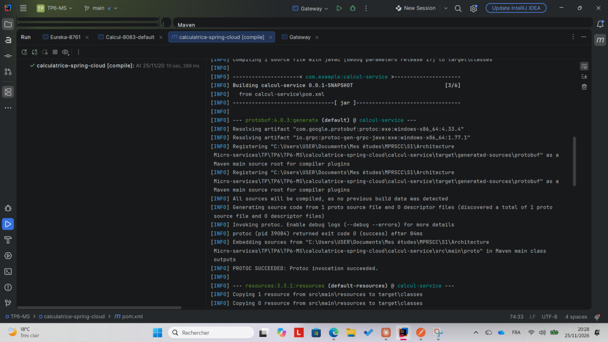

*Capture 1 — `mvn clean compile` : la ligne `protobuf:4.0.3:generate` s'exécute dans `calcul-service` avant la compilation Java et génère les sources.*

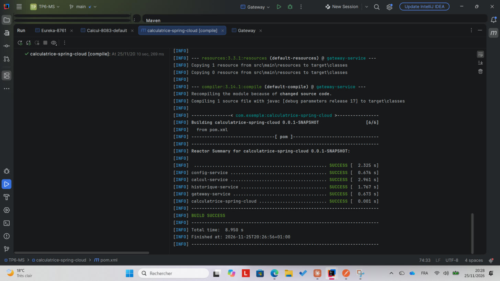

*Capture 2 — Résumé du réacteur : les six projets en `SUCCESS`, `BUILD SUCCESS`. `historique-service` génère ses classes de la même façon à partir de sa copie du contrat.*

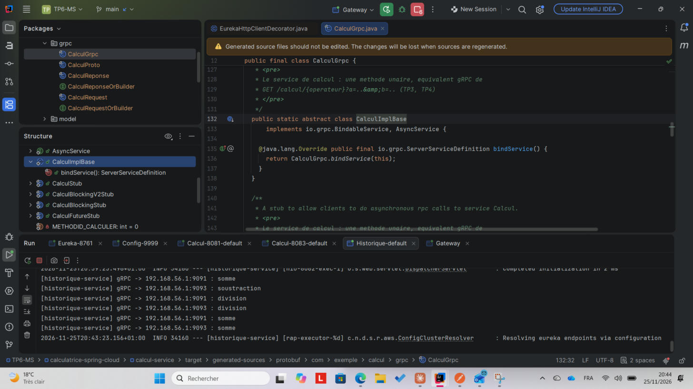

*Capture 3 — Code généré, `target/generated-sources/protobuf/com/exemple/calcul/grpc/CalculGrpc.java`, ouvert sur la classe `CalculImplBase` (à gauche, les six classes générées du paquetage `grpc`). IntelliJ signale que ce fichier généré ne doit pas être modifié.*

**Question B.1.** Si le serveur renumérote `resultat = 3` et `b = 4` sans que le client soit recompilé, le client interprète les octets d'après ses propres numéros : le champ 3 (désormais le résultat, un `double` encodé en 64 bits) serait lu comme `b` (un `int32`, type de fil différent) et le champ 4 serait lu comme `resultat`  les valeurs reçues seraient fausses ou ignorées, sans erreur de compilation. Renommer `resultat` en `valeur` sans changer son numéro ne casse rien : seul le numéro voyage sur le réseau, jamais le nom. Règle de compatibilité : on ne change ni ne réutilise jamais le numéro ou le type d'un champ existant ; on peut renommer, ajouter de nouveaux champs avec de nouveaux numéros et retirer un champ en réservant son numéro (`reserved`).

**Question B.2.** Le risque est la divergence des deux copies : si l'une est modifiée et pas l'autre, les deux microservices compilent, mais ne parlent plus la même langue, et l'erreur n'apparaît qu'à l'exécution (champs mal lus). Une organisation Maven qui l'éviterait : un module `calcul-api` ne contenant que le `.proto` et le plugin de génération, dont dépendent `calcul-service` et `historique-service` ; les classes sont alors générées une seule fois, à partir d'un seul fichier.

## 8. Partie C — calcul-service, serveur gRPC

### Démarrage (C.4)

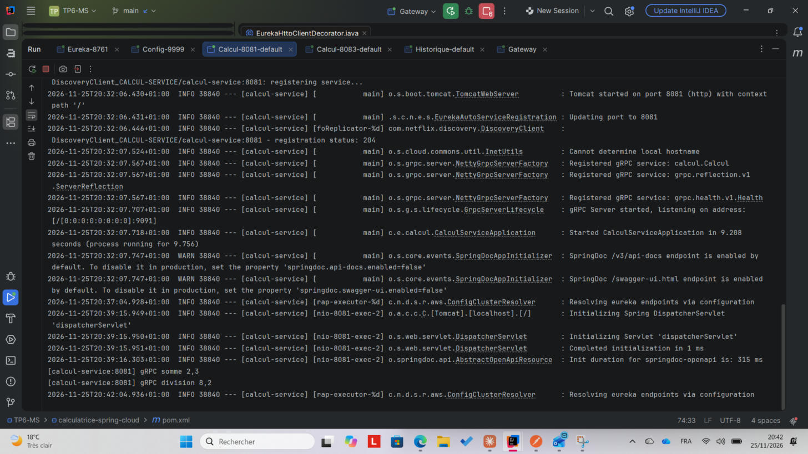

*Capture 4 — Console de l'instance 1 : `Tomcat started on port 8081`, enregistrement dans Eureka, `Registered gRPC service: calcul.Calcul` (avec réflexion et santé), `gRPC Server started, listening on address: [/[0:0:0:0:0:0:0:0]:9091]`. Les deux dernières lignes sont les traces de la régression finale : `gRPC somme 2,3` et `gRPC division 8,2` (alternance, voir D.1).*

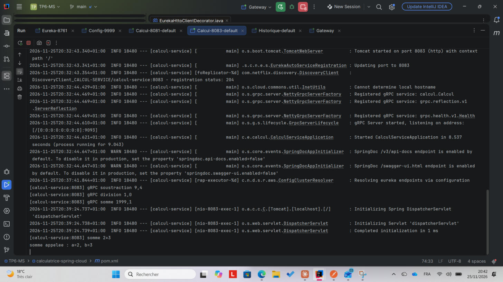

*Capture 5 — Même chose pour l'instance 2 : Tomcat 8083, serveur gRPC sur 9093, traces `gRPC soustraction 9,4`, `gRPC division 1,0`, `gRPC somme 1999,1`, puis la trace REST `somme 2+3` de l'appel GET passant par la passerelle.*

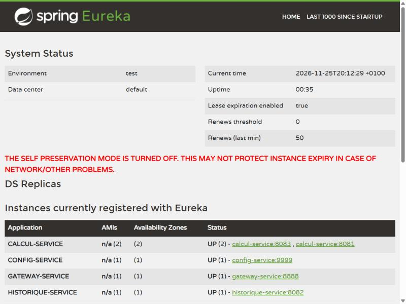

*Capture 6 — Tableau de bord Eureka : `CALCUL-SERVICE` UP (2) et les autres services.*

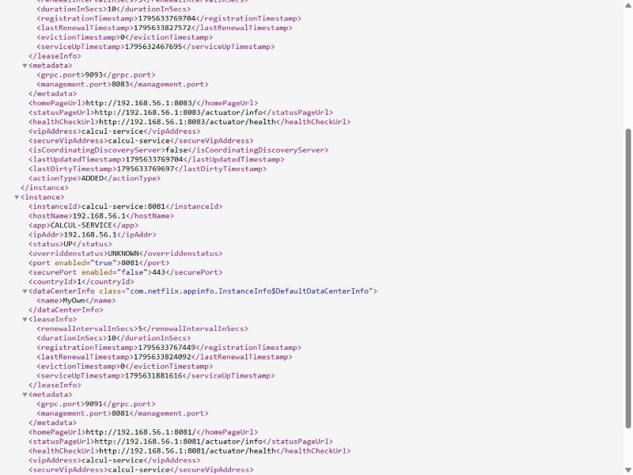

*Capture 7 — `http://localhost:8761/eureka/apps/CALCUL-SERVICE` : le bloc `<metadata>` de chaque instance contient `<grpc.port>9091</grpc.port>` (instance 8081) ou `<grpc.port>9093</grpc.port>` (instance 8083).*

Vérification de l'API REST, après le redémarrage final, via la passerelle : `GET /calcul-service/calcul/somme?a=2&b=3` répond `200` avec le corps `5`.

### Test avec Postman (C.5)

Postman, mode gRPC, adresse `localhost:9091` ou `localhost:9093`, méthode obtenue par réflexion. Les sept requêtes ont été exécutées.

| N° | Adresse | Message envoyé | Statut gRPC | Réponse obtenue | Instance |
|---|---|---|---|---|---|
| 1 | localhost:9091 | `{"operateur":"somme","a":8,"b":2}` | 0 OK | resultat 10, port 8081 | 8081 |
| 2 | localhost:9093 | `{"operateur":"produit","a":6,"b":7}` | 0 OK | resultat 42, port 8083 | 8083 |
| 3 | localhost:9091 | `{"operateur":"division","a":7,"b":2}` | 0 OK | resultat 3.5, port 8081 | 8081 |
| 4 | localhost:9091 | `{"operateur":"division","a":7,"b":0}` | 3 INVALID_ARGUMENT | « Erreur : Division par 0 impossible » | 8081 |
| 5 | localhost:9091 | `{"operateur":"racine","a":9,"b":0}` | 3 INVALID_ARGUMENT | « Erreur : Operateur inconnu : racine » | 8081 |
| 6 | localhost:9091 | `{"operateur":"somme","a":5000,"b":1}` | 3 INVALID_ARGUMENT | « Erreur : operande hors limite (max 2000) » | 8081 |
| 7 | localhost:9091 | `{"operateur":"somme"}` (a et b omis) | 0 OK | resultat 0, a 0, b 0, port 8081 (valeurs par défaut de proto3) | 8081 |

Les captures ci-dessous illustrent chaque type de scénario. Les requêtes 3, 5 et 7 sont regroupées dans une seule figure (capture 12 bis) ; chaque bloc montre le message envoyé en haut, puis le statut et la réponse en bas.

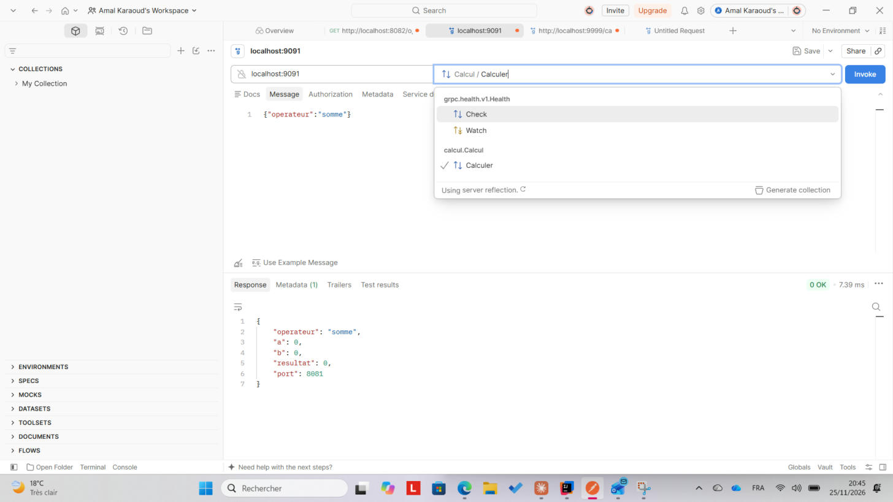

*Capture 8 — Liste des méthodes obtenue par réflexion (« Using server reflection ») sur `localhost:9091` : `grpc.health.v1.Health` (Check, Watch) et `calcul.Calcul` (Calculer). Aucun fichier `.proto` n'a été importé.*

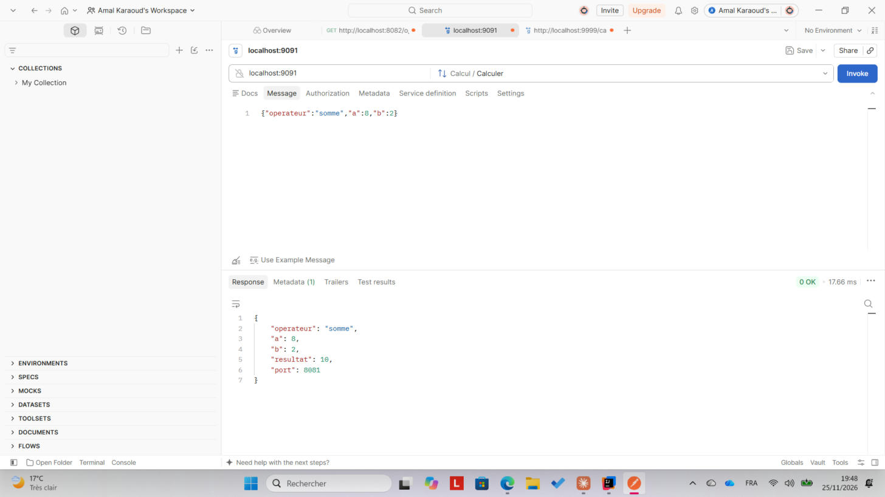

*Capture 9 — Requête 1 : `somme 8+2` sur 9091, statut `0 OK`, `resultat: 10`, `port: 8081` (cas nominal).*


*Capture 10 — Requête 2 : `produit 6×7` sur 9093, `0 OK`, `resultat: 42`, `port: 8083` : la seconde instance répond avec son propre port.*

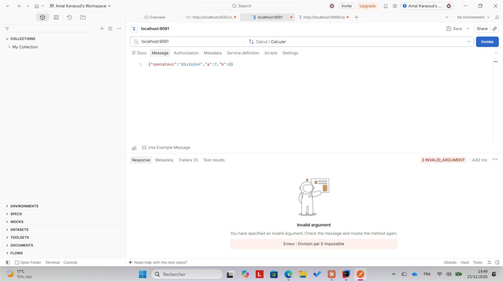

*Capture 11 — Requête 4 : `division 7/0`, statut `3 INVALID_ARGUMENT` : aucun message de réponse, seulement un statut et le détail « Erreur : Division par 0 impossible » (erreur attendue, traduite par le `GrpcExceptionHandler`).*

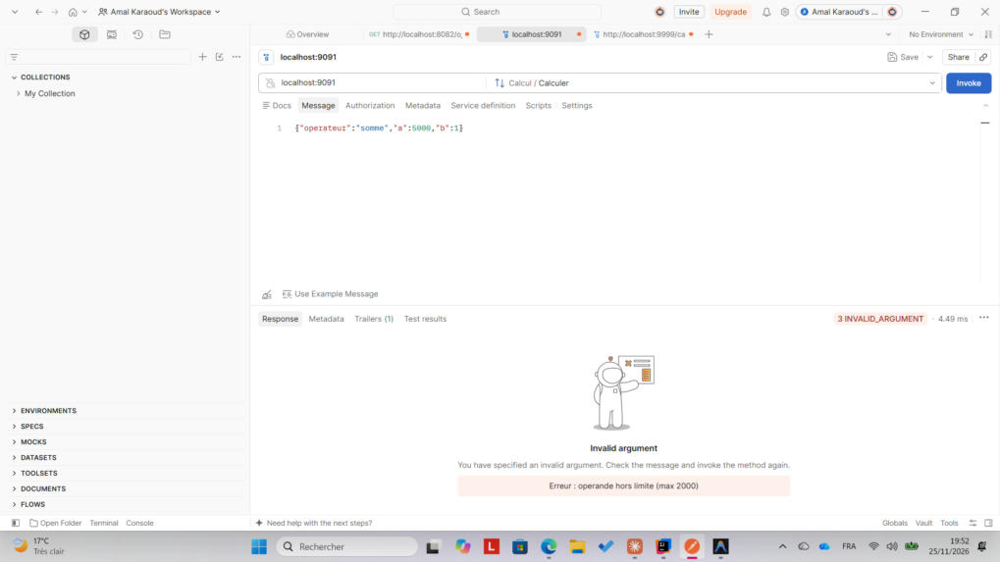

*Capture 12 — Requête 6 : `somme 5000+1`, `3 INVALID_ARGUMENT` « Erreur : operande hors limite (max 2000) » : la limite du dépôt de configuration s'applique aussi aux appels gRPC.*

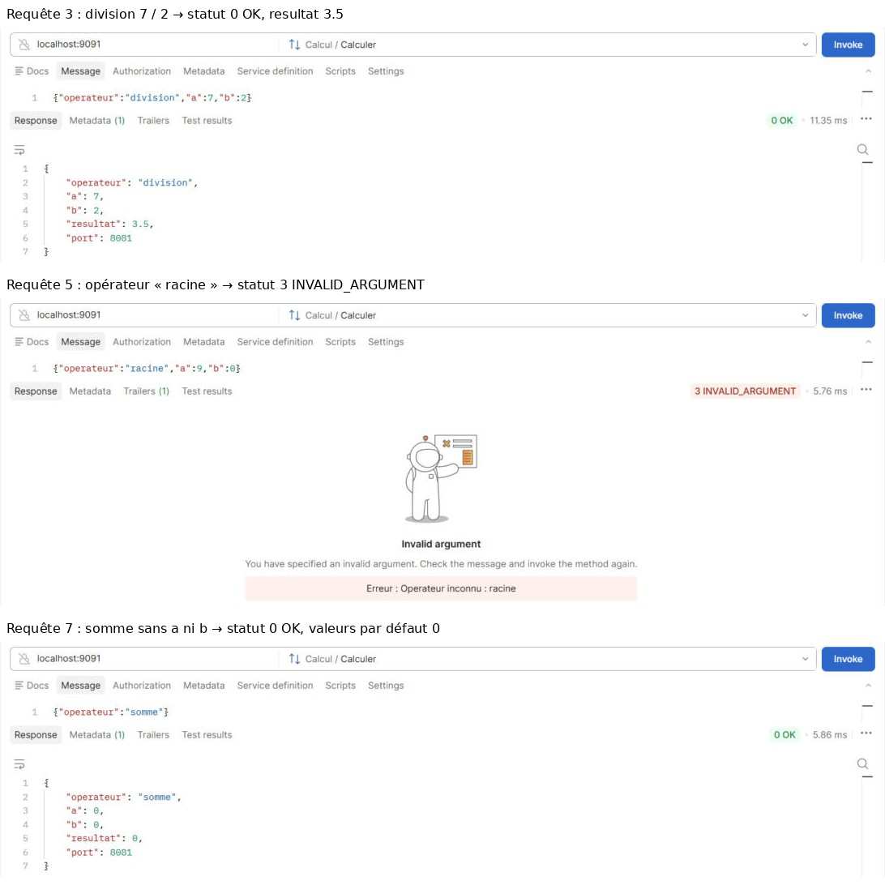

*Capture 12 bis — Requêtes 3, 5 et 7 : `division 7/2` donne `0 OK` et `resultat: 3.5` ; l'opérateur `racine` donne `3 INVALID_ARGUMENT` « Erreur : Operateur inconnu : racine » ; `somme` sans `a` ni `b` donne `0 OK` avec `a: 0`, `b: 0`, `resultat: 0` (valeurs par défaut de proto3). Les trois appels sont visibles dans la console de l'instance 8081 (capture 23).*

**Question C.1.** `CalculController` et `CalculGrpcService` sont deux portes d'entrée vers la même `Calculatrice` : toutes deux reçoivent des paramètres, vérifient la limite et l'opérateur, délèguent le calcul et renvoient un résultat. Elles se distinguent par le format (texte dans l'URL et corps `text/plain` en HTTP/1.1, contre messages Protobuf binaires sur HTTP/2), par les erreurs (statut HTTP 400 et corps texte contre statut gRPC `INVALID_ARGUMENT` et description) et par l'outil de test (Swagger UI contre Postman en mode gRPC). La logique de calcul n'est pas écrite dans l'une des deux classes pour n'exister qu'une fois, dans `Calculatrice` (une correction profite aux deux protocoles). La vérification de la limite et le choix de l'opérateur sont écrits deux fois ; pour qu'ils ne le soient qu'une fois, on les placerait dans la couche de service (`Calculatrice` ou une classe `CalculService` qui l'encapsule), qui lèverait les exceptions que chaque porte traduit à sa façon.

**Question C.2.** Le message d'erreur est dans le statut de l'appel : en gRPC, une erreur n'est pas une réponse mais un statut (code + description) renvoyé dans les trailers. Le client Java le lit dans le `StatusRuntimeException` levé par le stub : `e.getStatus().getCode()` pour le code (ici `INVALID_ARGUMENT`) et `e.getStatus().getDescription()` pour le texte. `OperationController` utilise précisément ces deux méthodes.

**Question C.3.** Au démarrage, le serveur enregistre le service de réflexion (`grpc.reflection.v1.ServerReflection`, visible dans la console). Postman l'interroge : le serveur décrit ses services (`calcul.Calcul`, `Health`) et leurs messages, et Postman en déduit la liste des méthodes et un message d'exemple, sans le `.proto`. En production, mieux vaut la désactiver : elle révèle toute l'interface du serveur à quiconque peut s'y connecter (voir synthèse 11).

## 9. Partie D — historique-service client gRPC

`CalculGrpcClient` demande à `DiscoveryClient` les instances de `calcul-service`, les trie par hôte et port, choisit la suivante avec un compteur (tour de rôle), lit `grpc.port` dans les métadonnées, réutilise un canal par adresse (`ConcurrentHashMap` + `GrpcChannelFactory`) et appelle le stub bloquant. `OperationController` traduit `INVALID_ARGUMENT` en 400 avec la description, et toute autre erreur gRPC ou l'absence d'instance en 503.

### D.1 — Alternance

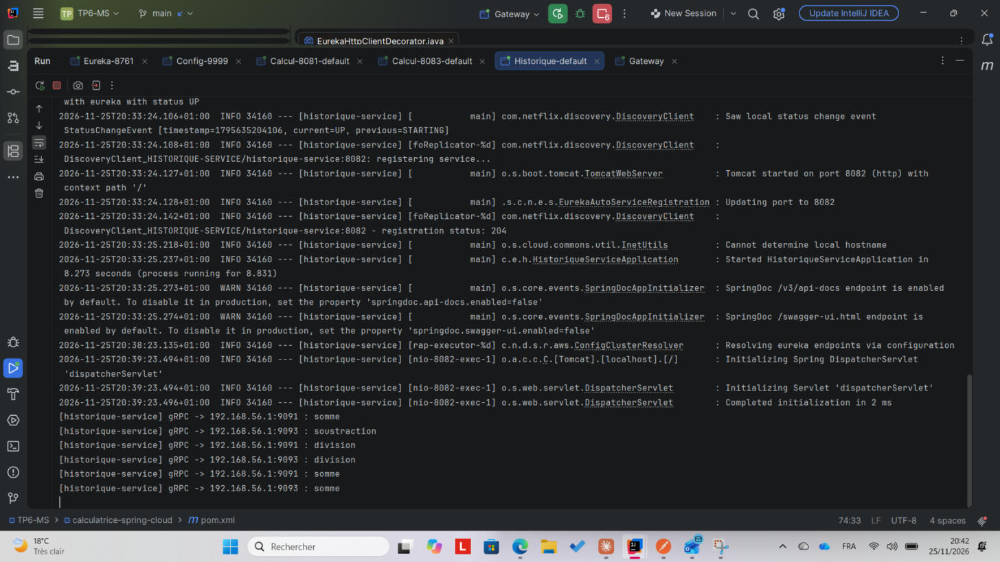

*Capture 13 — Console d'historique-service après le redémarrage final : six appels, dès le premier, `gRPC -> 192.168.56.1:9091`, puis `:9093`, `:9091`, `:9093`, `:9091`, `:9093` (somme, soustraction, division, division, somme, somme) : alternance stricte, et deux adresses seulement, donc deux canaux.*

### D.4 — Tests directs sur historique-service

Les requêtes ont été envoyées à `localhost:8082` (script Postman qui enchaîne les appels et affiche le tableau) ; elles ont été exécutées sur un historique vide, d'où les identifiants 1 à 3.

| N° | Requête | Corps | Statut | Réponse obtenue |
|---|---|---|---|---|
| 1 | POST /operations | `{"operateur":"somme","a":8,"b":2}` | 201 | `{"id":1,"operateur":"somme","a":8,"b":2,"resultat":10.0}` |
| 2 | POST /operations | `{"operateur":"produit","a":6,"b":7}` | 201 | `{"id":2,...,"resultat":42.0}` |
| 3 | POST /operations | `{"operateur":"division","a":7,"b":2}` | 201 | `{"id":3,...,"resultat":3.5}` |
| 4 | POST /operations | `{"operateur":"division","a":7,"b":0}` | 400 | `{"erreur":"Erreur : Division par 0 impossible"}` |
| 5 | POST /operations | `{"operateur":"racine","a":9,"b":0}` | 400 | `{"erreur":"Operateur inconnu : racine"}` (refusé par historique-service avant tout appel gRPC) |
| 6 | POST /operations | `{"operateur":"produit","a":5000,"b":2}` | 400 | `{"erreur":"Erreur : operande hors limite (max 2000)"}` |
| 7 | GET /operations | aucun | 200 | tableau des opérations 1 à 3 |
| 8 | PUT /operations/2 | `{"operateur":"somme","a":6,"b":7}` | 200 | `{"id":2,"operateur":"somme","a":6,"b":7,"resultat":13.0}` |

Les requêtes D.1 qui suivent dans le même tableau (somme 8+2 répétée) répondent `201` (identifiants à partir de 4).

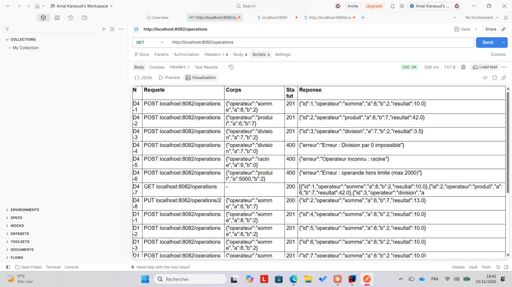

*Capture 14 — Tableau Postman des requêtes D.4 (1 à 8) puis D.1 : statuts et corps conformes à ceux du tableau ci-dessus.*

La trace de l'instance qui a répondu pour chaque requête est visible dans les consoles des captures 4, 5 et 13 : les appels alternent entre `[calcul-service:8081]` et `[calcul-service:8083]`, correspondant aux lignes `gRPC -> …:9091` et `…:9093` d'historique-service.

### D.2 — Expérience de la faute volontaire

La clé `"grpc.port"` a été remplacée provisoirement par `"grpc.prt"`, puis remise.

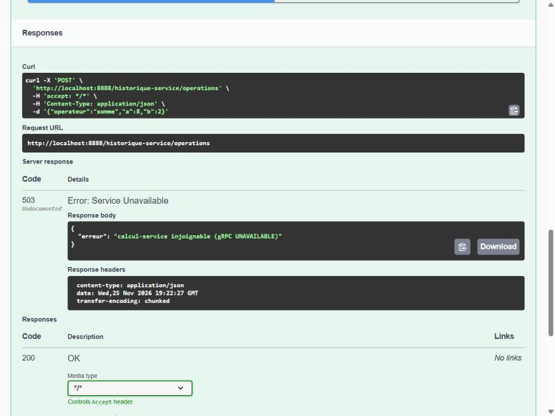

*Capture 15 — `POST /historique-service/operations` avec la faute : `503` et `{"erreur":"calcul-service injoignable (gRPC UNAVAILABLE)"}`.*

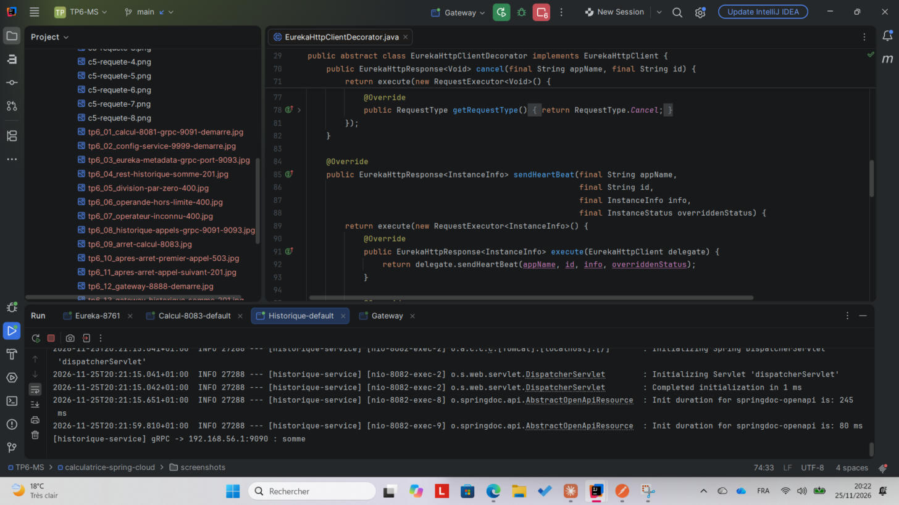

*Capture 16 — La console d'historique-service montre `gRPC -> 192.168.56.1:9090 : somme` : la clé introuvable fait prendre la valeur de repli 9090.*

### D.5 — Arrêt de l'instance 8083

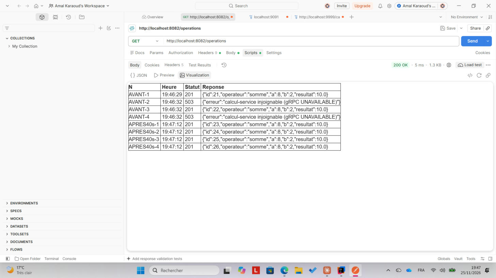

*Capture 17 — Quatre requêtes immédiatement après l'arrêt : `201`, `503`, `201`, `503` (une sur deux échoue) ; quarante secondes plus tard : quatre `201`.*

### Questions D

**Question D.1.** Sur les six appels de la capture 13, les instances alternent 8081, 8083, 8081, 8083, 8081, 8083 (9091, 9093, …). Au TP4, Spring Cloud LoadBalancer faisait la même répartition par tour de rôle, mais le choix était caché derrière `lb://` ; ici, le mécanisme est écrit dans `CalculGrpcClient`. Console d'historique-service : une ligne `gRPC -> …` par appel (six lignes dans la capture), et seulement deux canaux (deux adresses distinctes, 9091 et 9093), créés au premier appel de chacune puis réutilisés.

**Question D.2.** `503`, avec `calcul-service injoignable (gRPC UNAVAILABLE)` : la clé `grpc.prt` n'existe pas dans les métadonnées, `getOrDefault` renvoie la valeur de repli `"9090"`, et rien n'écoute sur le port 9090 (le port par défaut de Spring gRPC, que les instances n'utilisent pas ici car elles écoutent sur 9091 et 9093) ; la connexion échoue, d'où `UNAVAILABLE`.

**Question D.3.** Les lignes qui ont changé : l'injection (`CalculGrpcClient` à la place de `CalculClient`/Feign), l'appel (`calculGrpcClient.calculer(operateur, a, b)` qui retourne un `CalculReponse`) et la gestion des erreurs (`StatusRuntimeException` à la place de `FeignException.BadRequest` et `FeignException`). La conversion `Double.parseDouble` a disparu : le résultat n'est plus du texte ; le champ `resultat` du message est un `double` typé, et `op.setResultat(reponse.getResultat())` l'affecte directement.

**Question D.4.** Deux améliorations : (1) réessayer sur une autre instance quand le code est `UNAVAILABLE` (dans `calculer`, attraper l'erreur et rappeler avec l'instance suivante, avec un nombre d'essais limité) ; (2) activer le contrôle de santé côté client (`spring.grpc.client.channels.<nom>.health.enabled`) pour que le canal ne choisisse que des instances saines. Dans la même situation, Spring Cloud LoadBalancer (TP4) s'appuyait sur la même liste d'instances de l'annuaire, donc la même fenêtre existait ; mais il permettait d'ajouter par configuration un contrôle de santé des instances et des réessais, sans code écrit à la main.

## 10. Partie E — Passerelle et dépôt de configuration

### E.1 — Rien n'a changé pour le client

Requêtes envoyées sur `http://localhost:8888` après le redémarrage final (passerelle) :

| N° | Requête | Statut | Réponse obtenue | Qui a travaillé |
|---|---|---|---|---|
| 1 | POST /historique-service/operations `{"operateur":"soustraction","a":10,"b":4}` | 201 | `{"id":5,"operateur":"soustraction","a":10,"b":4,"resultat":6.0}` | passerelle → historique-service → gRPC → une instance de calcul-service |
| 2 | GET /calcul-service/calcul/somme?a=2&b=3 | 200 | `5` | passerelle → calcul-service en REST (trace `somme 2+3`, sans « gRPC ») |
| 3 | GET /historique-service/operations | 200 | tableau JSON des 5 opérations enregistrées | historique-service seul |
| 4 | GET /actuator/gateway/routes | 200 | quatre routes, une par service de l'annuaire (`lb://CALCUL-SERVICE`, `GATEWAY-SERVICE`, `HISTORIQUE-SERVICE`, `CONFIG-SERVICE`) | passerelle : aucune route ne mentionne les ports gRPC |

Ces appels ont été émis par un script exécuté dans le navigateur sur l'origine de la passerelle (même chemin d'accès que Swagger UI). Les requêtes 1 et 2 sont aussi illustrées par deux captures de Swagger UI (prises avant le redémarrage final) :

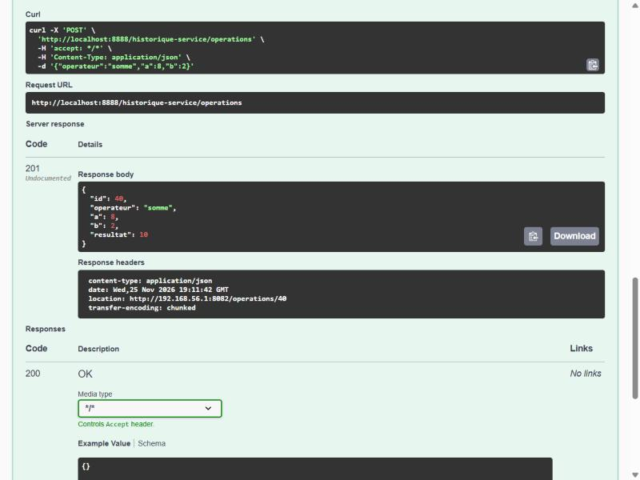

*Capture 18 — Swagger UI de la passerelle : `POST /historique-service/operations` avec `{"operateur":"somme","a":8,"b":2}` répond `201` avec `resultat: 10` (le trajet interne passe en gRPC, invisible du client).*

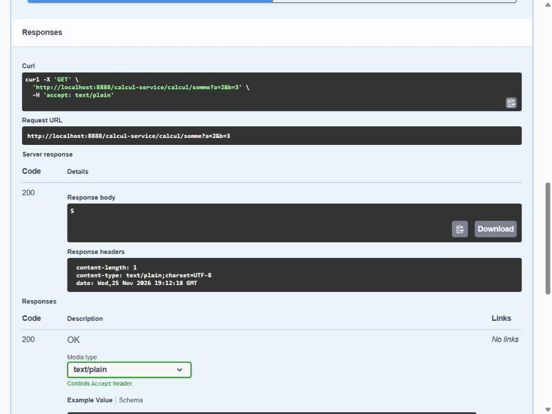

*Capture 19 — Swagger UI de la passerelle : `GET /calcul-service/calcul/somme?a=2&b=3` répond `200` avec `5` (API REST intacte).*

Observation : l'en-tête `Location` d'un `201` contient l'adresse d'historique-service (`http://192.168.56.1:8082/operations/5`) et non celle de la passerelle ; ce comportement existait avant ce TP et n'est pas lié à gRPC.

**Question E.1.** Non, pas avec la configuration de ce TP : Spring Cloud Gateway route du HTTP/REST vers les instances et ne connaît pas les ports 9091 et 9093. Pour exposer `calcul.Calcul/Calculer` à un client extérieur, il faudrait ajouter un proxy compatible HTTP/2 et gRPC, par exemple Envoy, qui route le trafic gRPC (HTTP/2) vers les instances ; pour un client navigateur, gRPC-Web (un traducteur, souvent dans Envoy) car un navigateur ne sait pas parler gRPC natif ; ou, selon la version, une route de passerelle gRPC (HTTP/2 avec les trailers).

### E.2 — Limite 500 puis 2000 dans le dépôt de configuration

Les deux commits ont été réalisés dans IntelliJ sur `C:\tp5-config\calculatrice-config-repo` : « E.2 : abaisse calcul.max-operande a 500 (configuration centralisee) » puis « E.2 : restaure calcul.max-operande a 2000 (configuration par defaut) ». Le Config Server renvoie la valeur du dépôt, puis `POST /actuator/refresh` est envoyé à chaque instance. Chaque ligne du tableau suivant est une requête réelle ; les requêtes passent par historique-service (`POST /operations`) ; `{"operateur":"somme","a":600,"b":1}` est la requête de test.

Scénario 1 : limite abaissée à 500.

| Étape | Statut | Réponse | Interprétation |
|---|---|---|---|
| Config Server | 200 | `calcul.max-operande=500` et `calcul.message=Limite abaissee a 500 (TP6, E.2)` | Le dépôt est servi |
| 4 requêtes avant tout refresh | 201 ×4 | `resultat` 601.0 (id 27 à 30) | Aucune instance n'a rechargé : limite 2000 |
| `POST /actuator/refresh` sur 8081 | 200 | `["config.client.version","calcul.message","calcul.max-operande"]` | Propriétés modifiées |
| 4 requêtes (8081 rafraîchie seule) | 400, 201, 400, 201 | « Erreur : operande hors limite (max 500) » / 601.0 | Une instance sur deux applique 500 (alternance) |
| `POST /actuator/refresh` sur 8083 | 200 | même liste | |
| 4 requêtes (toutes rafraîchies) | 400 ×4 | « Erreur : operande hors limite (max 500) » | Instances cohérentes |
| Contrôle `somme 8+2` | 201 | `resultat` 10.0 | Les petites valeurs passent |

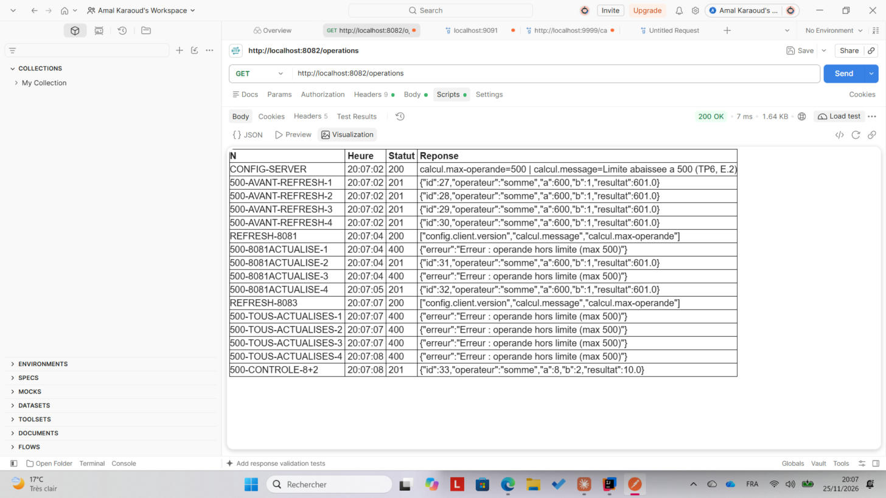

*Capture 20 — Tableau du scénario 1 (limite 500) : l'effet de la nouvelle limite sur les appels gRPC, sans redémarrage, instance par instance.*

Scénario 2 : limite restaurée à 2000.

| Étape | Statut | Réponse | Interprétation |
|---|---|---|---|
| Config Server | 200 | `calcul.max-operande=2000` et `calcul.message=Configuration par defaut (profil default)` | Dépôt restauré |
| 4 requêtes avant refresh | 400 ×4 | « (max 500) » | Les instances gardent 500 |
| `POST /actuator/refresh` sur 8081 | 200 | liste des propriétés modifiées | |
| 4 requêtes | 400, 201, 400, 201 | « (max 500) » / 601.0 (id 34, 35) | Alternance : une instance sur deux |
| `POST /actuator/refresh` sur 8083 | 200 | | |
| 4 requêtes | 201 ×4 | `resultat` 601.0 (id 36 à 39) | Instances cohérentes à 2000 |
| `somme 2500+1` (deux fois) | 400 ×2 | « Erreur : operande hors limite (max 2000) » | La limite 2000 s'applique toujours |

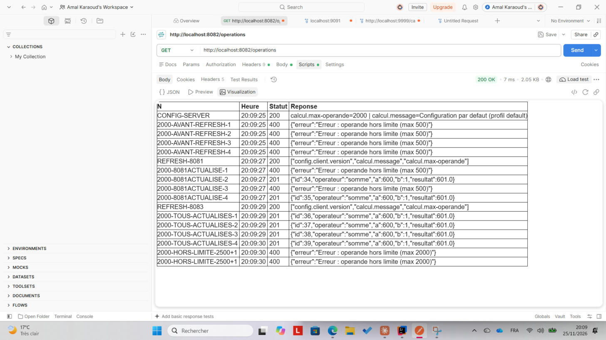

*Capture 21 — Tableau du scénario 2 : retour à 2000, toujours sans redémarrage, puis refus de 2500 avec « max 2000 ».*

Le Config Server confirme l'état final après le redémarrage complet : `calcul.max-operande=2000` (réponse de `http://localhost:9999/calcul-service/default`, version `5c36af2…`), et `GET /calcul-service/calcul/config` renvoie `maxOperande 2000`, `GET /historique-service/operations/config` renvoie `maxOperations 50`, profil `default` pour les deux.

**Question E.2.** `CalculController` lit la limite par `@Value` dans un bean `@RefreshScope` : la valeur est lue à la création du bean et recalculée seulement quand le bean est détruit et recréé par le refresh. `CalculGrpcService` la lit dans l'`Environment` à chaque appel : la valeur est toujours à jour, car l'`Environment` est mis à jour par le refresh. Le bean qui ne doit pas être enveloppé dans un proxy (ici le service gRPC, que le serveur doit pouvoir enregistrer) doit utiliser l'approche `Environment`. L'inconvénient de cette approche pour une propriété lue des milliers de fois par seconde : chaque lecture parcourt les sources de propriétés et convertit la chaîne en entier, un coût que l'on évite en mettant la valeur en cache dans un champ rechargé seulement au refresh.

**Question E.3.** REST direct (TP3) : le client est Swagger UI/Postman/la passerelle, le contrat est implicite (annotations de `CalculController`), l'adresse est connue par la passerelle via l'annuaire ou saisie à la main. REST appelé par OpenFeign (TP4) : le client est `historique-service`, le contrat est l'interface `@FeignClient` (non vérifié à la compilation), l'adresse est résolue par Spring Cloud LoadBalancer à partir du nom `lb://calcul-service`. gRPC (ce TP) : le client est `historique-service`, le contrat est `calcul.proto`, l'adresse est lue dans l'annuaire (hôte + métadonnée `grpc.port`). Si l'on n'en gardait que deux, on supprimerait l'appel REST par OpenFeign, qui fait double emploi avec gRPC pour le même usage (un appel interne entre deux services) ; on garderait REST pour l'extérieur et gRPC à l'intérieur.

### E.3 — Streaming serveur

Le contrat des deux fichiers `calcul.proto` (identiques) reçoit une seconde méthode, un flux serveur :

```
service Calcul {
  rpc Calculer (CalculRequest) returns (CalculReponse);
  // Flux serveur : une requete, N reponses (la table de multiplication de a, de 1 a b)
  rpc Table (CalculRequest) returns (stream CalculReponse);
}
```

`CalculGrpcService` redéfinit `table` : pour `i` de 1 à `b`, un `onNext` avec `produit a × i` (champ `port` renseigné), une pause de 500 ms, puis un seul `onCompleted`. La limite `calcul.max-operande` est aussi appliquée à `a` et à `b` (ajout par rapport au texte du TP, pour qu'un flux démesuré ne puisse pas être demandé). Les deux modules ont été recompilés (`BUILD SUCCESS`, classes régénérées par `protobuf:generate`), puis les instances 8081 et 8083 ont été relancées.

Test : Postman, `localhost:9091`, méthode `Table` (apparue après un rechargement de la réflexion du serveur), message `{"operateur":"produit","a":7,"b":10}`.

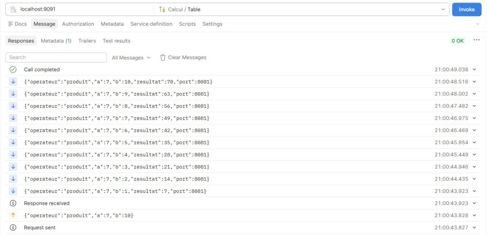

*Capture 22 — Les dix messages `7 × 1` à `7 × 10` (résultats 7, 14, …, 70, `port: 8081`) arrivent un par un, espacés d'environ 500 ms (horodatages 21:00:43.923 à 21:00:48.516), suivis de « Call completed » et du statut `0 OK`.*

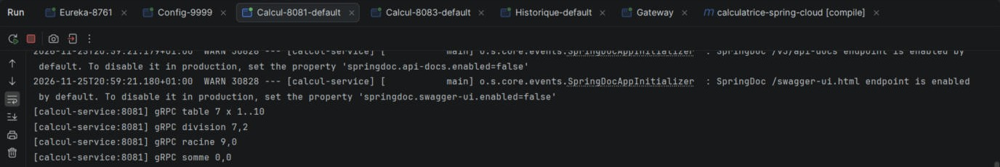

*Capture 23 — Console de l'instance 8081 après le test : `gRPC table 7 x 1..10`, puis les trois requêtes C.5 3, 5 et 7 (`division 7,2`, `racine 9,0`, `somme 0,0`).*

Côté client Java, le stub bloquant renverrait un `Iterator<CalculReponse>` parcouru par `while (it.hasNext())` ; `CalculGrpcClient` n'utilise pas cette méthode (hors du périmètre demandé), elle n'a donc été testée que par Postman.

**Question E.4.** En REST (TP3), il faudrait une requête HTTP par ligne de la table (dix requêtes pour `b = 10`), ou une technique de flux : SSE (Server-Sent Events) pour un flux serveur vers client, ou WebSocket pour un échange bidirectionnel. En gRPC, une seule requête suffit, le serveur répond par un flux de messages sur la même connexion HTTP/2. Un flux client (streaming client) aurait du sens pour envoyer une suite d'opérandes à additionner : le client envoie les nombres au fil de l'eau et le serveur répond une seule fois, avec la somme à la fin.

## 11. Questions de synthèse

**1.** Lignes du tableau A.3 et étape où la différence est observée : contrat (B.1, B.3 : le `.proto` et le code généré) ; format des données (C.5 : messages typés, `resultat` en `double`, valeurs par défaut en requête 7) ; transport HTTP/2 (D.1 : un canal par instance, deux canaux dans la console) ; code client (D.2 : le stub `CalculBlockingStub` et `CalculGrpcClient`) ; choix de l'instance (D.1 : tour de rôle écrit à la main) ; ports (C.4 : 9091 et 9093, Eureka C.4 capture 7) ; erreurs d'appel (C.5 requêtes 4 à 6 et D.2, D.5 : `INVALID_ARGUMENT`, `UNAVAILABLE`) ; erreurs côté service (C.2 : `GrpcExceptionHandler`) ; test direct (C.5 : Postman) ; dépendances Maven (B.2/D.1 : pom) ; configuration (E.2 : limite du dépôt appliquée aux appels gRPC) ; API REST, passerelle, Swagger inchangés (E.1).

**2.** Trajet de `POST :8888/historique-service/operations` avec `{"operateur":"somme","a":1,"b":2}` : (1) Swagger UI envoie le POST JSON en HTTP à la passerelle (8888). (2) La passerelle interroge l'annuaire (copie locale d'Eureka) pour `HISTORIQUE-SERVICE`, puis transmet la requête en HTTP/JSON à historique-service (8082). (3) `OperationController` appelle `CalculGrpcClient`, qui interroge la copie locale de l'annuaire (`DiscoveryClient.getInstances("calcul-service")`), choisit une instance au tour de rôle et lit `grpc.port`. (4) Le stub envoie `CalculRequest{somme,1,2}` en Protobuf sur HTTP/2 au serveur gRPC (9091 ou 9093). (5) `CalculGrpcService` vérifie la limite, appelle `Calculatrice.somme` et renvoie `CalculReponse{somme,1,2,3.0,port}`. (6) historique-service range le résultat, l'enregistre et répond `201` avec le JSON de l'opération à la passerelle, qui répond à Swagger UI. Les consultations de l'annuaire sont faites par la passerelle (nom `HISTORIQUE-SERVICE`) et par `CalculGrpcClient` (nom `calcul-service`).

**3.** Trois erreurs possibles au TP4 qui sont devenues des erreurs de compilation : un nom de méthode ou de champ inexistant dans l'appel (`stub.calculerr(...)`, `getResultats()`) ; un type incompatible dans un champ (un `String` passé là où le message attend un `int32`, ou l'inverse) ; un message construit sans les bons setters ou lu avec un getter inexistant (le message n'a plus la forme décrite par le contrat). Au TP4, une faute dans `@GetMapping("/calcul/{operateur}")` ou dans les noms de paramètres ne se voyait qu'à l'exécution (404).

**4.** Notre tour de rôle fait : récupérer la liste d'instances de l'annuaire, la trier pour que l'ordre soit stable, alterner entre les instances avec un compteur, créer un canal par instance et le réutiliser. Il ne fait pas, contrairement à Spring Cloud LoadBalancer : de cache de la liste d'instances propre (il lit la copie locale de l'annuaire), de contrôle de santé des instances (il choisit encore une instance arrêtée, d'où les 503 de D.5), de réessais sur une autre instance, ni de statistiques ou de stratégie de répartition configurable.

**5.** Eureka n'enregistre qu'un port par instance (le port HTTP). La métadonnée `grpc.port` publie le second port : sans elle, le client ne peut pas construire l'adresse gRPC (D.2). Si deux instances sur la même machine partageaient le même port gRPC, la seconde échouerait au démarrage (`Address already in use`) ; sur deux machines différentes, le même numéro ne poserait pas de problème.

**6.** `spring.grpc.server.port` : fichier local (`application.properties` ou argument de lancement), car il est propre à chaque instance, comme `server.port`. `eureka.instance.metadata-map.grpc.port=${spring.grpc.server.port}` : dépôt Git, car la ligne est identique pour toutes les instances et le placeholder est résolu localement par chacune. La limite `calcul.max-operande` du dépôt agit sur les appels gRPC sans redémarrage, après un `POST /actuator/refresh` sur chaque instance, grâce à `CalculGrpcService`, qui relit la valeur dans l'`Environment` à chaque appel (E.2).

**7.** Pour ajouter une opération `puissance`, il faudrait toucher, dans l'ordre : `Calculatrice` (méthode `puissance`) ; `CalculController` (route REST) ; `CalculGrpcService` (cas `puissance` dans le `switch`) ; `OperationController` (ajouter l'opérateur à la liste autorisée dans `OPERATEURS`). Aucun fichier généré n'est à modifier : le `.proto` ne change pas, car `operateur` est une chaîne ; seuls les fichiers écrits à la main sont touchés.

**8.** On garderait REST/JSON : pour une API publique appelée par des navigateurs ou des clients tiers (outillage, cache HTTP, Swagger), et pour des échanges peu fréquents où la simplicité et la lisibilité priment sur le débit. gRPC s'impose : pour des appels internes fréquents entre services où le contrat typé et la compacité comptent, et pour du streaming (flux serveur, client ou bidirectionnel). Frontière dans la calculatrice : REST vers l'extérieur (passerelle, Swagger UI), gRPC à l'intérieur (historique-service vers calcul-service).

**9.** Côté serveur, `CalculGrpc.CalculImplBase` (classe abstraite que `CalculGrpcService` étend) ; côté client, `CalculGrpc.CalculBlockingStub` (obtenu par `CalculGrpc.newBlockingStub(canal)`). Les deux sont des classes internes de `CalculGrpc`, générée par `protoc-gen-grpc-java` à partir du fichier `calcul.proto`, dans chaque module qui a une copie du fichier.

**10.** Voir la section 4 : un `mvn clean package -DskipTests` à la racine construit les six modules et lance `protoc` dans les deux modules qui ont un `.proto` ; puis un `java -jar` par programme, dans l'ordre eureka, config, calcul (8081 puis 8083 avec `--server.port=8083 --spring.grpc.server.port=9093`), historique, gateway. Ces commandes n'ont pas été exécutées en ligne de commande pour ce rendu (voir la section 12).

**11.** Sans TLS, les messages circulent en clair : le trafic peut être lu ou modifié sur le réseau ; correction : TLS (Spring gRPC, configuration des canaux et du serveur avec certificats, mTLS). Sans authentification, n'importe quel client qui atteint le port peut appeler le service ; correction : authentification par jeton (intercepteur gRPC, Spring Security avec JWT ou mTLS). Avec la réflexion activée, le service décrit toute son interface à un attaquant ; correction : la désactiver en production (retirer `grpc-services` ou désactiver le service de réflexion par propriété).

**12.** Au TP4 (OpenFeign) : passerelle → historique-service en HTTP/JSON, puis historique-service → calcul-service en HTTP (GET `/calcul/{operateur}`, réponse texte) avec choix de l'instance par LoadBalancer. Dans ce TP : le segment historique-service → calcul-service est passé en gRPC (Protobuf sur HTTP/2) avec choix de l'instance par `CalculGrpcClient`. Les segments Swagger UI → passerelle et passerelle → historique-service restent en HTTP/JSON et sont visibles du client ; le segment gRPC reste interne.


Les quatre derniers commits datent de ce TP. L'adresse e-mail des auteurs a été normalisée dans l'archive après les tests, sans changer le contenu des fichiers : les identifiants de commit diffèrent donc de ceux relevés pendant les tests (par exemple `5c36af2` pour le dernier, cité dans la partie E.2 ; c'est `01fff4e` dans l'archive).

L'historique du projet `calculatrice-spring-cloud` est celui de ce dépôt (`git log --oneline`).
